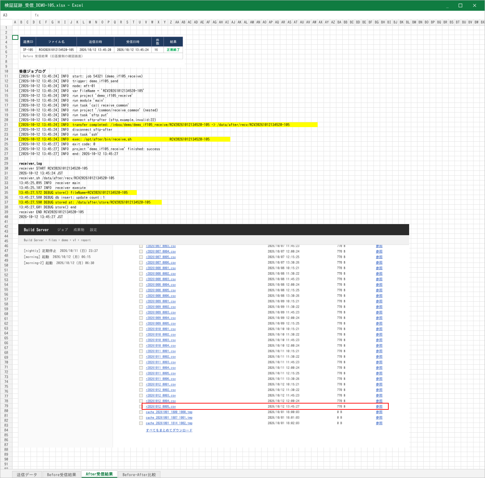
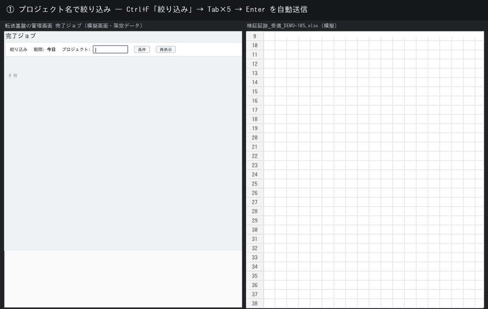
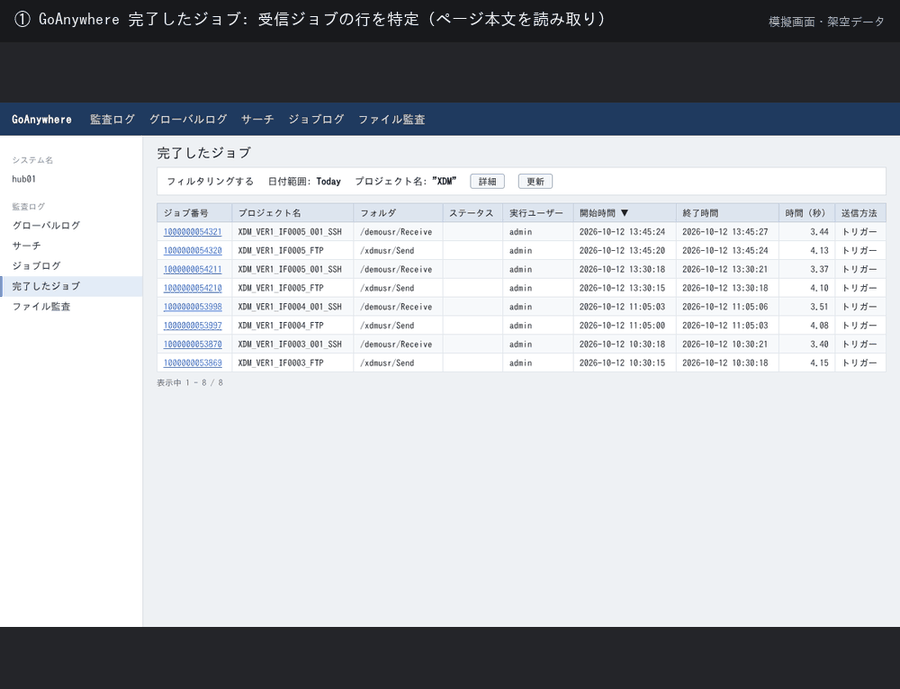
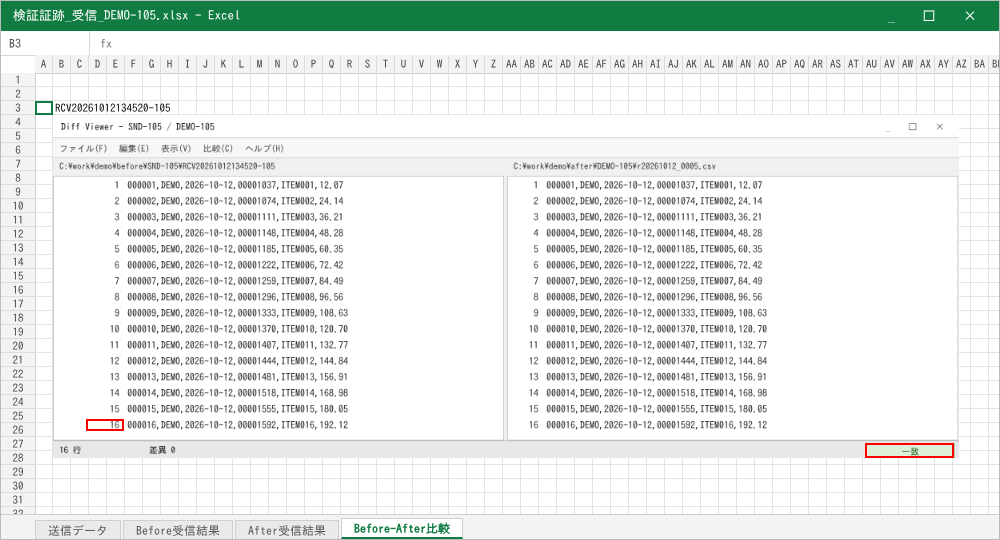
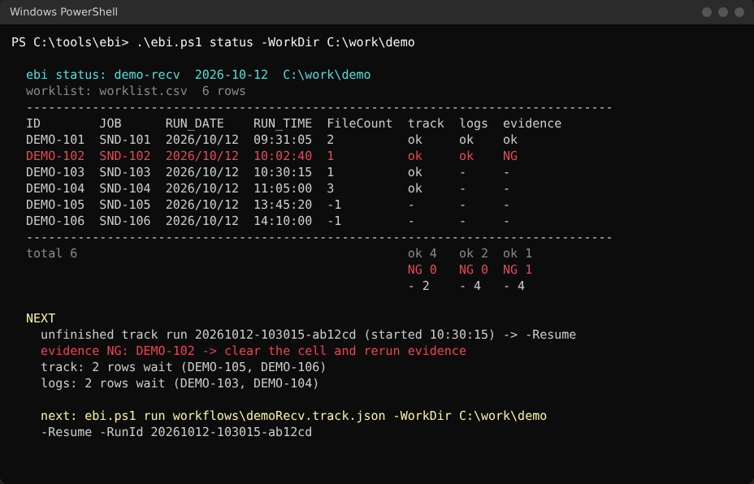
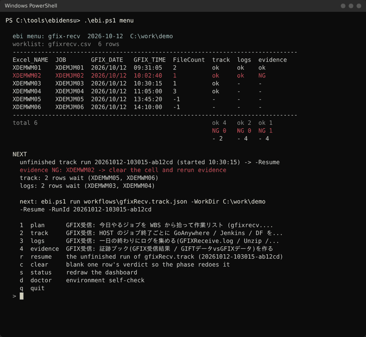

# VerifyTool

[日本語](#日本語) | [English](#english) | [中文](#中文)

---

## 日本語

ファイル転送基盤（GIFT→GFIX）移行案件で、証跡（エビデンス）作成を自動化する
PowerShell ツールです。対象 PC は Windows 10/11 + PowerShell 5.1 + Excel 2019
のみ、追加インストールなし。実案件で日々使っています。

### 毎回の手作業（Before）

受信ジョブ 1 件ごとに、SE が手でやっていたこと：

1. 転送基盤の管理画面（完了ジョブ一覧）で該当行を探す → スクリーンショット
2. 配信サーバのファイル一覧から受信ファイルを探してダウンロード
3. 差分ツールで移行前（Before）と移行後（After）のファイルを比較 → スクリーンショット
4. 証跡 Excel にジョブログを **1 行 1 セル** で貼る → 該当行を **黄色** に塗る（幅も揃える）
5. 受信バッチのログから該当ブロックだけ抜き出して貼る → 黄色
6. ファイル一覧のスクリーンショットを貼り、受信ファイルの行に **赤枠**
7. 差分ツールのキャプチャを貼り、最終行番号と「一致」に赤枠
8. 進捗を CSV に記録、レビュー依頼

1 件あたり約 0.3 人日。黄色の幅がずれる、赤枠が 1 行ずれる、貼り忘れ――
レビューで戻ってくるのは、たいていこの手作業の部分でした。

### After：1 コマンドで証跡ブックができる



ジョブログの貼り付け、黄色マーカー（幅は文字数 ÷ 3 列で計算）、受信バッチログの
START..END 抜き出し、ファイル一覧画面の挿入と受信ファイル行への赤枠――ここまでを
ツールが行い、SE は最後に Excel を目で見て Enter を押すだけです。



左が内部システム（模擬）、右が証跡 Excel（模擬）。絞り込み・該当行の特定・キャプチャ・
ジョブログの取得・貼り付け・黄色・赤枠まで、人がキーボードに触るところはありません。





> 画像はすべて **架空データ・模擬画面** です。画面の名前、ジョブ名、ファイル名、ログの書式も
> 実案件とは別のものに置き換えてあります（社内画面や実際の証跡は載せていません）。
> CI 環境（Linux, PowerShell 7）には Excel がないため、Excel を操作する実装と
> **同じ純粋関数**（黄色の幅 `Get-EbiHighlightEndColumn`、赤枠の位置
> `Get-EbiListEntryRects` / `Resolve-EbiAnchoredRect`、ログの切り出し
> `Get-EbiLogBlocks`）が出した計算結果を、そのまま HTML で描いています。

### 一日の流れを一画面に（ebi status / ebi menu）

受信日は 4 本のワークフロー（朝の plan、HOST ジョブごとの track、夕方の logs、
最後の evidence）で回します。`ebi status` は作業リスト CSV を一画面にまとめ
（1 行 1 案件、各フェーズの判定、合計、途中で止まった run、次に打つ 1 行）、
`ebi menu`（`ebi.cmd` をダブルクリック）はフェーズを選ぶと手順書と同じ
`ebi.ps1 run ...` を表示してそのまま実行します。



### 結果

1 件あたりの作業時間が 0.3 人日から 0.1 人日未満へ短縮しました（同僚に確認した
見積りによる）。レビューで戻る理由だった「幅」「行ずれ」「貼り忘れ」は、計算で
決まる部分になりました。

### 設計上の判断

「動くツール」と「現場に根づくツール」は別だと考え、以下を意識しました。

- **段階的な確認モード**: 最初から全自動にはせず、判定結果を都度確認できるモードを用意しました。誤検知を早期に発見できないと、利用者が結果を信用できなくなるためです。
- **分からないときは止まる**: 画面の文字と突き合わせて「違うページ」「該当行なし」「行数が合わない」を検知したら、推測せずに人に聞きます。監査用の証跡なので、自信のある誤りは無回答より悪い。
- **カスタマイズの余地**: 枠の位置、黄色にする行のパターン、シート名や文言は profile（JSON）側にあり、案件ごとの違いや仕様変更に対応できる構成にしました。
- **利用者に使ってもらうまで**: 導入前に既存の手作業と結果を突き合わせ、差分がないことを確認したうえで展開しました。

### 使い方

```powershell
# 初代ツール（HM / MQ / Jenkins の証跡、メニュー式）
.\VerifyTool.ps1
.\VerifyTool.ps1 -Phase Status

# ワークフローエンジン（GFIX 受信日）
.\ebi.ps1 status -WorkDir C:\work\today      # 一画面の進捗
.\ebi.ps1 menu                               # 入口（ebi.cmd のダブルクリックと同じ）
.\ebi.ps1 run workflows\gfixRecv.evidence.json -WorkDir C:\work\today -Only XDEMWM05
```

手順書：[`docs/gfix-recv/RUNBOOK.zh.md`](docs/gfix-recv/RUNBOOK.zh.md)（中国語）。

---

## English

> **从一个人的证据工具，到可复用的工作流构建器。**
> *From one operator's evidence tool to a reusable workflow builder.*

A migration project produces evidence: screenshots of the batch-status page, of
the transfer queue, of the CI job that moved the file — each pasted into the
right sheet of the right workbook, annotated, cross-checked, logged, reviewed
and delivered. For a few hundred data-transfer jobs, that is weeks of careful
clicking, and a single mis-pasted screenshot is a defect that ships.

**VerifyTool turns that into one command.** It drives the browser and Excel on
the operator's own machine, captures each page, files it, marks it, verifies it
against what the page actually said, and tracks every job's state so the work
can stop and resume at any point.

It runs on a locked-down Windows remote desktop with **PowerShell 5.1 and Excel
2019 and nothing else installed** — no runtime, no package manager, no
third-party library.

### What the evidence looks like

The second job this repository took on runs on its newer half, the
declarative workflow engine `ebi` (`ebi.ps1`, `kernel/`, `modules/`,
`workflows/`, `profiles/`): GFIX receive verification. Per received job the
operator used to screenshot three internal pages, paste a job log into the
evidence workbook one line per cell, paint the right lines yellow (at the
right width), cut the matching block out of a batch log, paste a file-list
screenshot and draw a red box on the received file's row, then do the same
for the diff-tool comparison. That is now one command and a final glance.


*Every picture is fictional data on mock pages, with the page names, job
names, file names and log formats changed from the real site's. The CI container has no
Excel, so the pictures are drawn in HTML from the output of the same pure
functions the Excel steps call: `Get-EbiHighlightEndColumn` for the yellow
width (characters / 3 columns, measured on the delivered sample),
`Get-EbiListEntryRects` / `Resolve-EbiAnchoredRect` for the red boxes,
`Get-EbiLogBlocks` for the START..END cut.*

### What it looks like

One entry point. It reads the current state, tells you what to do next, and
runs it:

```text
PS> .\VerifyTool.ps1

===== Current mapping status =====
  Rows: 257
  Mapping                : 257/257 done, 0 pending  [isMapped]
  GiftHmSnap             : 257/257 done, 0 pending  [GIFT_HM_snap]
  GiftMqSnap             : 251/257 done, 6 pending  [GIFT_MQ_snap]
  ReplaceGift            : 240/257 done, 17 pending  [isReplaced bit=1]
  MarkGift               : 0/257 done, 257 pending  [isMarked bit=1]
  ...

Recommended next: GiftMqSnap

Choose phase:
   1  InitConfig           work-folder config JSON (verify_config.json)
   2  Mapping              mapping 生成 / 更新
   5  GiftMqSnap           GIFT MQ 証跡
  16  ReplaceGift          GIFT 証跡置換 bit=1
  19  ProcessTime          処理時間 抽出 (証跡 Excel 生成) bit=3
  ...
   s  Status only
   h  Help
   q  Quit

phase [GiftMqSnap]:
```

*(The operator-facing labels are Japanese — this is a tool for a Japanese
site. The code itself is ASCII-only; see [Working on it](#working-on-it).)*

Every phase is reachable from this menu, remembers its own settings between
runs, and can be limited to specific jobs. Flags exist for scripting
(`-Phase`, `-TargetIds`, `-DryRun`, …) — see [`docs/Operations.md`](docs/Operations.md) —
but day to day you just run `.\VerifyTool.ps1` and answer prompts.

### A receive day in one screen

The day is four JSON workflows (morning `plan`, one `track` round per HOST
job, end-of-day `logs`, the `evidence` workbook) over one worklist CSV.
After the first full office day the operator was typing four long run lines
from the runbook and reading progress by opening the CSV in Notepad.

**`ebi status`** is the read-only answer: one row per deliverable, the
verdict of every phase, totals, the runs that stopped half-way, and the one
line to run next. **`ebi menu`** (or a double-click on `ebi.cmd`) picks a
phase, optionally one job, prints exactly the runbook line and runs it; `r`
resumes the unfinished run, `c` blanks one verdict for a redo.




Nothing on that screen is project-specific code: the phases are the
workflows that name the profile, their order is the order of their verdict
columns in the profile's `worklist.json`, the columns shown are declared
there too. Operator guide: [`docs/gfix-recv/RUNBOOK.zh.md`](docs/gfix-recv/RUNBOOK.zh.md).

### The pipeline

State lives in one CSV (`mapping_<Owner>.csv`), one row per data-transfer job.
Each phase reads the rows still pending for it, does its work, and marks them.
Nothing is order-dependent beyond the arrows; interrupt anywhere and re-run.

```text
  Mapping ── generate the job list from the project's WBS workbook
     │
  Capture ── GIFT/GFIX × HM · MQ · Jenkins · DF diff  ─────► snap\*.png + page text
     │        (browser driven, each capture verified against the page's own text)
     │
  Clone ──── create one evidence workbook per deliverable
     │
  Align ──── compare against the J4 baseline before touching anything
     │
  Replace ── paste the captures into the right sheet, in review order
     │
  Mark ───── draw the red boxes on the cells a reviewer must look at
     │
  ProcessTime ─ read each batch's start/end time back off the evidence,
     │           cross-check it, and build the processing-time workbook
     │
  Review ─── walk a human through every job, one keystroke each
     │
  Deliver ── check sheet · J4 file transfer · Outlook review-request drafts
```

### Why it is built this way

The constraint that shaped everything: **the target machine cannot be changed.**
No admin rights, no installer, no internet, an old remote desktop session that
someone else owns. So:

| Need | What most tools reach for | What VerifyTool uses |
|---|---|---|
| Drive the browser | Selenium / Playwright | `SendKeys` + window activation, page text via the clipboard |
| Read text from a screenshot | Tesseract, a cloud OCR API | `Windows.Media.Ocr` — the engine already behind Snipping Tool |
| Write Excel | EPPlus, ClosedXML, openpyxl | Excel COM (the operator's own Excel) |
| Image work | ImageMagick, OpenCV | `System.Drawing` |
| Unzip | 7-Zip | `System.IO.Compression` |
| Email | an SMTP library | Outlook COM — as a **draft**, never auto-sent |

Total third-party dependencies: **zero**. Everything above ships with Windows.
Copy the folder onto the machine and it runs.

*(The one exception is `mock-page/`, a node-only test harness for developing
OCR logic off-site. It never runs on the operator's PC, and it is currently
[parked](docs/Parked-Ideas.md).)*

#### Testable where it matters

COM, `SendKeys` and screen capture cannot be exercised in CI. So every piece of
real logic is pulled out into a **pure module** — no COM, no I/O, no screen —
and unit-tested:

```powershell
.\Tests\Run-Tests.ps1     # parse-checks every .ps1, then runs the unit suites
```

Parsing an OCR'd table, deciding which log belongs to which job, resolving a
file name, planning what goes where in a workbook, judging whether a capture is
NG — all of it is pure and covered. The COM shells around them stay thin enough
to review by eye.

#### It says "I don't know" out loud

The tool automates evidence for an audit, so a confidently wrong answer is worse
than no answer. The rules it holds itself to:

- **Only act when the answer is forced.** The Japanese OCR engine confuses
  MS Gothic `9` and `3`. A digit is corrected only when exactly one substitution
  is arithmetically possible — a minute of `93` can only ever have been `33`; a
  start/end pair that disagrees with the page's own printed duration is fixed
  only if exactly one swap reconciles all three readings. Anything ambiguous is
  **left exactly as read and marked red** for a human. It never "improves" a
  plausible value.
- **Preview before touching shared documents.** The team's review check sheet is
  filled in a temp copy first, shown to you, and committed only if the original
  has not changed meanwhile.
- **Never send.** Review-request mail opens as a draft; a human clicks Send.
- **Atomic state.** The mapping CSV is written atomically, and every phase
  appends to an append-only `status\progress.jsonl` you can tail live from
  another shell without locking anything.
- **Verify the capture, not just take it.** Each screenshot is checked against
  the page's own text — right page, right job, right time window, no abend —
  and a failed check keeps the row pending instead of banking a bad screenshot.

### Status

This is a **working tool in daily production use**, and deliberately a
**readable sample project**: one real, messy, end-to-end workflow, automated
under real-world constraints, with the reasoning left in the code.

It is currently specific to one migration project. A properly decoupled
version — where the phases, the page definitions and the workbook layout are
described in configuration rather than written into the scripts — is in active
development; see [`docs/Generalization-Roadmap.md`](docs/Generalization-Roadmap.md)
for where that is going.

Already generalized: everything project-specific that could be moved out lives
in `VerifyConfig.psd1`, and any work folder can override all of it with a
`verify_config.json` overlay — window sizes, red-box coordinates, sheet names,
mail templates, expected-time rules, output routing.

### Documentation

| | |
|---|---|
| [`docs/Operations.md`](docs/Operations.md) | day-to-day reference: every phase, its options, the folder layout, the mapping columns |
| [`docs/Configuration.md`](docs/Configuration.md) | the three config layers and which one a setting belongs in |
| [`docs/Generalization-Roadmap.md`](docs/Generalization-Roadmap.md) | where the decoupled version is heading |
| [`docs/SnapVerify-Plan.md`](docs/SnapVerify-Plan.md) | how a capture is judged OK or NG |
| [`docs/SendVsGift.md`](docs/SendVsGift.md) | send-vs-GIFT metadata comparison |
| [`docs/Versioning.md`](docs/Versioning.md) | version bump rules |
| [`docs/Parked-Ideas.md`](docs/Parked-Ideas.md) | designed, then deliberately shelved — and what it would take to resume |
| [`CLAUDE.md`](CLAUDE.md) | full architecture map; read this first when opening the repo in an IDE or an LLM session |
| [`CHANGELOG.md`](CHANGELOG.md) | per-version history |

### Working on it

```powershell
.\Tests\Run-Tests.ps1        # parse check + unit tests
.\Check-Encoding.ps1         # enforce the source encoding policy
```

Two rules that are easy to trip over:

- **`.ps1` source stays ASCII.** Japanese used at runtime is built from code
  points in `ProjectLabels.ps1`. Raw Japanese in a BOM-less script mojibakes on
  a Japanese-locale host, which once silently broke owner matching.
- **Only files without a `param()` block are ever dot-sourced.** Dot-sourcing a
  script that has one overwrites the caller's switch parameters with `$false`.

Both are checked; `CLAUDE.md` has the full conventions.

#### Cross-environment workflow

Development happens away from the office PC, which has no git access:

```text
office PC  →  Pack-LlmContext.ps1    → clipboard → paste into an LLM session
LLM        →  XML patch or git diff  → clipboard → Apply-LlmPatch.ps1 → local files
end of day →  Export-DailyPatch.ps1  → clipboard → commit from home
```

---

## 中文

一个 PowerShell 工具，自动化文件传输平台迁移（GIFT→GFIX）项目里的「证据」制作。
目标机器只有 Windows 10/11 + PowerShell 5.1 + Excel 2019，不能装任何东西。实际项目每天在用。

### 之前的重复劳动

每接收一个作业，SE 要手工做：在传输平台的管理页面里找到那一行并截图；在分发服务器的
文件一览里找到接收文件并下载；用差分工具比较迁移前（Before）和迁移后（After）的文件并截图；把作业日志
**一行一格**贴进证据 Excel，把关键行**涂黄**（宽度还得对齐）；从接收批处理的日志里
只抠出这一次传输的块再贴、再涂黄；贴文件一览截图并在接收文件那一行**画红框**；贴差分
截图并在最后一行行号和「一致」上画红框；最后在 CSV 里记进度。每件约 0.3 人日，
而评审打回来的，多半就是黄条宽度、红框错行、漏贴这些。

### 之后：一条命令生成证据工作簿


> 所有图片都是**虚构数据和模拟页面**，页面名、作业名、文件名、日志格式也都换成了与实际现场
> 不同的写法。CI 环境（Linux、PowerShell 7）没有 Excel，
> 所以图是用 HTML 画的，但黄条宽度、红框位置、日志切块都来自操作 Excel 的实现
> 所调用的**同一批纯函数**（`Get-EbiHighlightEndColumn`、`Get-EbiListEntryRects`、
> `Resolve-EbiAnchoredRect`、`Get-EbiLogBlocks`）。

### 一天的进度在一屏里

接收日由 4 条 JSON 工作流组成（早上 plan、每个 HOST 作业一轮 track、傍晚 logs、
最后 evidence）。`ebi status` 把作业清单 CSV 汇成一屏（一行一本、每阶段判定、合计、
没跑完的 run、下一条该打的命令）；`ebi menu`（双击 `ebi.cmd`）选阶段后原样打印并执行
runbook 里那行 `ebi.ps1 run ...`。


### 结果与取舍

每件从 0.3 人日降到 0.1 人日以下（同事估算）。设计上：不一上来就全自动，先有逐条确认
的模式；页面文字对不上、找不到行、行数不符时停下来问人而不是猜（这是审计用证据，
自信的错误比没答案更糟）；框的位置、涂黄的模式、工作表名都放在 profile（JSON）里，
换项目改数据不改代码；上线前把工具产出和既有手工结果逐一比对过。

操作手册：[`docs/gfix-recv/RUNBOOK.zh.md`](docs/gfix-recv/RUNBOOK.zh.md)。
